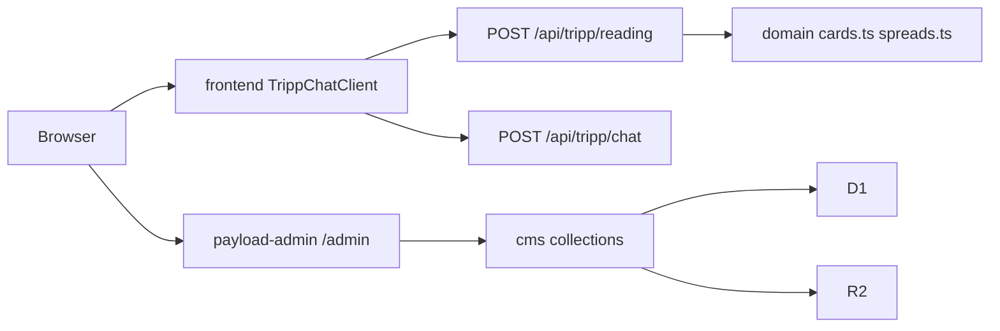

# Architecture

Current map of `tripp-admin` as of 2026-10-10 (commit `ed88d14` on `main`, plus this standards change). Directories below exist. The last section is target state and is not built.

## What runs

A Next.js 16 App Router app, built for Cloudflare Workers with `@opennextjs/cloudflare`. Payload CMS 3.82 owns `/admin` and the generated REST and GraphQL routes. A separate tarot HTTP surface lives under `/api/tripp/*`. The reading and chat domain library in `src/lib/tripp` is only partly used by those routes.

## Modules

| Module | Path | Responsibility |
| --- | --- | --- |
| frontend | `src/app/(frontend)` | Public Next page. `TrippChatClient` posts to `/api/tripp/reading` and `/api/tripp/chat`. Layout metadata still says "Payload Blank Template". |
| payload-admin | `src/app/(payload)` | Payload admin shell (`/admin`) and generated REST (`/api/[...slug]`) plus GraphQL routes. |
| tripp-http | `src/app/api/tripp`, `src/app/my-route` | HTTP adapters. `cards`, `spreads`, and `status` read the in-memory deck. `reading` draws cards and returns a fixed Vietnamese write-up. `chat` returns a fixed reflective reply. `seed` writes Cards and Spreads through Payload when those collections are empty. `my-route` is the template example and does not serve the product. |
| cms | `src/collections`, `src/payload.config.ts`, `src/migrations`, `src/payload-types.ts` | Payload collections and D1 migrations. Collections: Users (roles owner, admin, editor, viewer), Media, Cards, Spreads, ContextFlows, ReadingSessions, AuditLogs. Config binds D1 and R2 and loads the collection modules. |
| domain | `src/lib/tripp` | Tarot catalog, conversation policy, prompt assembly, and the reading session engine. Public catalog entry points used today: `cards.ts`, `spreads.ts`, `seed-data.ts`. Intended session entry point, not imported by any route: `reading-api.ts` (`readReading`, `handleReadingAction`, `handleClientToolAction`). |
| static-client | `public/tripp` | Static TRIPP chat (`app.js`, `index.html`) and studio (`admin.js`, `admin.html`). Not the Next page at `/`. |
| platform | `wrangler.jsonc`, `open-next.config.ts`, `next.config.ts`, `src/empty-shim.ts`, `cloudflare-env.d.ts` | Worker name `tripp-admin`, bindings, OpenNext config, and the drizzle-kit shim so the Worker build can resolve Payload's optional dependency. `cloudflare-env.d.ts` is generated. |
| tests | `tests` | Vitest integration test boots Payload and lists users. Playwright covers `/admin` and a frontend spec that still expects the blank template heading. |

`src/lib/tripp` files, and who calls them from outside the folder:

| Entry | Used by routes today | Role |
| --- | --- | --- |
| `cards.ts`, `spreads.ts` | `cards`, `spreads`, `status`, `reading` | 78-card deck and six spread configs. Draw uses `crypto.getRandomValues`. |
| `seed-data.ts` | `seed` | Maps the deck and spreads into Payload create payloads. |
| `reading-api.ts` | nobody | Session actions, client tools, model calls. |
| `reading-schema.ts`, `reading-flow.ts`, `reading-decision.ts`, `reading-inference.ts`, `reading-output.ts`, `reading-knowledge.ts`, `reading-diagnostics.ts` | nobody outside `domain` | Session state, commands, model prompts, output gates. |
| `decision.ts`, `policy.ts`, `conversation.ts`, `context-feeding.ts`, `context-flow.ts`, `prompt-parts.ts`, `prompt-requirements.ts` | nobody outside `domain` | Chat policy, history, and prompt composition. |
| `inference.ts`, `reply-provider.ts`, `reply-schema.ts`, `reply-text.ts`, `quick-options.ts` | nobody outside `domain` | Workers AI call path and reply checks. |
| `client-tools.ts`, `server-tools.ts` | nobody outside `domain` | UI tool contract and server-side card grounding. |

`reading-api.ts` imports `./admin-auth` and `./admin-runtime`. Those files are not in the tree. It also types a `DEMO_STATE` Durable Object namespace. `wrangler.jsonc` does not bind a Durable Object.

Inside `domain`, files import sibling files directly. That is one module, not a cross-module import. There is no `index.ts` barrel.

## Dependency direction

Allowed today, and what the code actually does:

```text
frontend  -->  tripp-http  -->  domain catalog (cards, spreads, seed-data)
tripp-http seed  -->  cms (Payload getPayload)
payload-admin  -->  cms  -->  D1, R2
cms migrations  -->  D1
domain engine  -->  Workers AI   (only if something calls reading-api; nothing does)
static-client  -->  paths that are not routes in this app
```

`domain` does not import Next, Payload, or Wrangler. `cms` does not import `domain`. `frontend` does not import `domain`.

Cross-module deep imports that already violate the entry-point rule:

- None from `frontend` or `payload-admin` into `domain` internals.
- `tripp-http` imports catalog modules, which are the real entry points, and does not import prompt or session internals.
- The session engine's own entry (`reading-api.ts`) is unused, so the live reading and chat behavior is inlined in the route files instead of going through it.

## External services

Declared in `wrangler.jsonc` and `src/payload.config.ts`:

| Binding | Service | What uses it |
| --- | --- | --- |
| `D1` | Cloudflare D1 database `tripp-admin` | Payload via `sqliteD1Adapter` in `src/payload.config.ts`. Migrations in `src/migrations`. |
| `R2` | Cloudflare R2 bucket `tripp-admin` | `@payloadcms/storage-r2` for the Media collection. |
| `AI` | Cloudflare Workers AI | Binding exists. `REPLY_MODEL` var is `@cf/qwen/qwen3-30b-a3b-fp8`. `reply-provider.ts` can call that model, or `openai/gpt-6-luna` through an AI Gateway when `AI_GATEWAY_ID` is set. No route calls it. |
| `ASSETS` | Worker assets from `.open-next/assets` | OpenNext static assets. |
| `WORKER_SELF_REFERENCE` | This Worker | OpenNext self-reference. |

Not configured, but named in domain code: Durable Object `DEMO_STATE`, and the admin HTTP API the static studio calls (`/api/admin/auth/*`, `/api/admin/flow/*`, `/api/admin/users`).

The static client calls `/api/reading`, `/api/reading/action`, `/api/spreads`, `/api/config`, and `/api/client-tools/{register,call,revoke}`. This app's routes are `/api/tripp/*` plus Payload's `/api/<collection>`. `public/tripp/index.html` also loads `/app.js` and `/styles.css` from the site root; the files on disk are `/tripp/app.js` and `/tripp/styles.css`.

## Request path that actually serves `/`



`chat` does not call `catalog` or Workers AI. Seed is a separate POST `/api/tripp/seed` that writes through Payload into D1. It is not on the page's path.

## Target boundaries

Not built. Do not add these as new packages or interfaces until a change needs them. One implementation means a function in the module that already exists, not a new interface.

1. `tripp-http` is the only adapter in front of `domain`. Reading and chat routes call `reading-api.ts` or the catalog entry points. They do not grow a second interpreter beside the engine.
2. `admin-auth` and `admin-runtime` are missing files, not modules. A change that mounts `reading-api.ts` either adds those two files because the existing imports need them, or stops importing them. Do not invent a third admin stack next to Payload.
3. Session persistence is one adapter. `ReadingSessions` is the D1 collection that already exists. `DEMO_STATE` is a named Durable Object that is not bound. Pick one when the engine is mounted. Do not add both.
4. `static-client` is a client of whatever HTTP entry `tripp-http` publishes. It is not a second domain and it does not get its own copy of the deck.
5. `cms` stays the Payload adapter for D1 and R2. `domain` keeps taking plain values and an env object. It does not import Payload.
6. Platform bindings stay in `wrangler.jsonc` and `src/payload.config.ts`. Feature code reads them from the env those files already expose.
